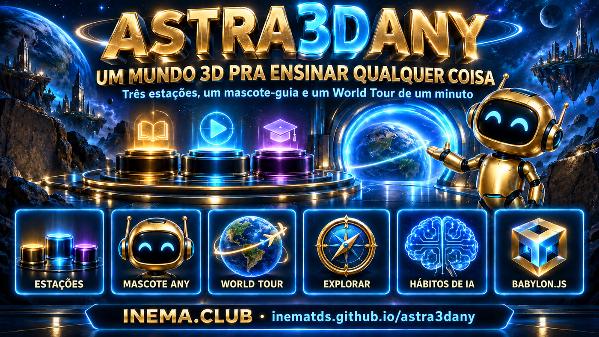

# astra3dany — um mundo 3D pra ensinar qualquer coisa

**🇧🇷 [Português](README.md) · 🇺🇸 [English](README.en.md) · 🇪🇸 [Español](README.es.md)**

[](https://inematds.github.io/astra3dany/guia/)

**Ao vivo:** https://inematds.github.io/astra3dany/app/ · **Guia de uso:** https://inematds.github.io/astra3dany/guia/

Um "mundo de aprendizagem" em miniatura, no browser: três estações, um mascote-guia, um World Tour ritmado e exploração livre.
Cada estação mostra **uma ideia acontecendo** (antes → depois) com um card que explica o que você vê, o que está acontecendo e o que lembrar.

O primeiro mundo ensina **"IA no dia a dia: três hábitos que evitam problemas"**, em português, pra adultos que começam a usar IA no trabalho:

| # | Estação | Hábito | O que acontece |
|---|---|---|---|
| 01 | O portão | Confirme antes de agir | Um pedido é barrado e vai pra revisão; o segundo passa na checagem, o portão abre e a ação roda |
| 02 | As gavetas | Dê contexto onde a IA lê | O card de instruções entra na gaveta do projeto e os dois colegas ficam conectados |
| 03 | A conferência | Confira a fonte | O formato passa; a conferência corrige o total de 100 pra 90 e deixa a data em aberto |

Segue a receita do field guide **Build a Learning World** (Mark Kashef, comunidade Early AI Adopters): seis partes, ritmo de câmera *chegar → aproximar → demonstrar → segurar*, cards sincronizados e checklist de aceite. O material de estudo está em [`docs/`](docs/00-INDICE.md); a síntese em [`docs/05-sintese.md`](docs/05-sintese.md); o plano em [`PLANO.md`](PLANO.md); as evidências de inspeção em [`evidence/revisao.md`](evidence/revisao.md).

## 📖 Guia de uso

Guia completo (landing + passo a passo): **https://inematds.github.io/astra3dany/guia/**

## Instalação

Pré-requisitos:

- **Node.js 20 ou mais novo** (desenvolvido e testado com Node 24.13) e **npm**.
- Um browser com **WebGL2** (Chrome, Edge, Firefox, Safari 15+). Não precisa de GPU dedicada, mas ajuda.
- Nada de backend, chave de API, banco ou Blender: o site é 100% estático.

```bash
git clone https://github.com/inematds/astra3dany.git
cd astra3dany/game
npm ci                 # instala exatamente as versões do package-lock (Vite 8.2.2, Babylon.js 9.25.0)
npm run dev            # servidor de desenvolvimento em http://127.0.0.1:43220
```

Outros comandos, sempre dentro de `game/`:

| Comando | O que faz |
|---|---|
| `npm test` | 7 testes do timeline e das legendas do tour (`node --test`, sem browser) |
| `npm run build` | gera o site estático em **`../app/`** (caminhos relativos, serve de qualquer pasta) |
| `npm run preview` | serve o build de `../app/` em http://127.0.0.1:43221 pra inspecionar o que vai pro ar |

Sem internet o `npm run dev` funciona normalmente depois do `npm ci`; nenhum asset vem de CDN.

## Uso

**Abrir:** https://inematds.github.io/astra3dany/app/ (ou o `npm run dev`). Acrescente `?diagnostics` à URL pra ver fps, p95 e resolução de render no canto do palco.

**World Tour** (botão laranja): ~60 segundos guiados. Por estação: chegada (3 s) → aproximação (3 s) → demonstração (6 s) → resultado parado (5 s); no fim, o recap com os três hábitos.
- *Pausar / Retomar* congela câmera e demonstração (também pela barra de espaço ou pelo link "Pausar pra ler" no card).
- *Reiniciar* volta ao início; *0,75× / 1×* muda a velocidade; *Sair* ou `Esc` volta pra visão geral.
- No desktop o card fica à direita e a cena é renderizada ao lado dele; no celular o card fica embaixo. O card nunca cobre a demonstração.

**Explorar no seu ritmo:** clique num pedestal (ou nos botões 01/02/03).
- *Ver de perto e rodar* aproxima a câmera e roda a demonstração; *Repetir a demonstração* roda de novo; *Vista ampla* recua; *Próxima estação* avança; a terceira leva ao recap.
- A frase do card muda junto com o que está acontecendo na cena; na estação 3 os valores (total e data) aparecem também em texto.

**Câmera livre** (fora do tour):

| Ação | Mouse | Teclado | Touch |
|---|---|---|---|
| Orbitar | arrastar | setas | um dedo |
| Aproximar / afastar | roda, botões + e − | `+` / `-` | pinça |
| Deslocar (pan) | shift + arrastar, botão direito ou do meio | — | dois dedos |
| Voltar ao enquadramento | botão *Reset* | `R` | botão *Reset* |

**Reduzir movimento:** respeita `prefers-reduced-motion` do sistema e pode ser alternado no topo. Com ele ligado a câmera pula direto pra cada pose em vez de animar; as demonstrações continuam.

**Fontes e créditos:** link no rodapé da barra lateral.

## Trocar o assunto (ensinar outra coisa)

1. Edite **`game/src/mundo.config.js`**: título, intro, público, mascote e as três estações (nome, princípio, explicação, sequência, observações por tempo da demo, takeaway, poses de câmera). Todo o texto do site vem daí.
2. Se a mecânica de uma estação for diferente, crie um módulo em `game/src/estacoes/` com a interface `{ reset(), update(demoTime), foco, pick }` e registre em `DEMOS` no `main.js`. Os três módulos existentes servem de molde: são metáforas físicas que já se mostraram legíveis em close-up.
3. Rode `npm test` (os testes leem o config: duração, holds de 5 s, frases por fase) e inspecione no browser: vista ampla, close-up, demo, resultado, desktop e celular.

Regra do guia: *mude o assunto, mantenha a receita*. Uma estação = um princípio = uma metáfora física = uma mudança visível.

## Limites conhecidos

- **Mascote procedural.** Blender não estava disponível na máquina de build (aarch64), então o mascote Any é gerado em código (`game/src/mascote.js`). Pra usar um asset Blender, exporte um GLB pra `game/public/assets/`, aponte `mascote.glb` no config e nomeie as pernas `Perna1..4` (ou `Leg1..4`) pra ganhar o andar.
- **Tamanho.** O bundle principal tem ~5,8 MB (1,2 MB gzip) por causa do Babylon.js; a primeira carga em 4G leva alguns segundos. Não há code-splitting ainda.
- **Desempenho.** Só foi medido em Chromium headless com WebGL por software (25–35 fps), o que não representa um dispositivo real. Em GPU comum espera-se 60 fps; em celulares antigos, reduza `hardwareScalingLevel` no `main.js` ou desligue as sombras no `palco.js`.
- **Não testado** em aparelho físico, Safari ou Firefox, nem com gestos de toque reais (a pinça foi exercitada só por código).
- **Sem áudio, sem quiz, sem IA ao vivo.** As demonstrações são animações determinísticas; voz/música ficam pra uma próxima versão.
- **Uma língua.** Textos em português no config; não há i18n.
- **Acessibilidade parcial.** Botões e painéis são navegáveis por teclado e o card do tour é `aria-live`, mas a cena 3D em si não tem descrição alternativa além dos cards.

## Publicar

`npm run build` gera `app/` (estático, caminhos relativos). O repositório serve pelo **GitHub Pages a partir da raiz da branch `main`**, então basta commitar `app/` e o `guia/` e fazer push:

- App: `https://inematds.github.io/astra3dany/app/`
- Guia: `https://inematds.github.io/astra3dany/guia/`

Serve igualmente em Vercel, Netlify ou Here.Now apontando pra pasta `app/`. Publique sempre o build que foi inspecionado no `npm run preview`.

## Estrutura

```
app/                          build estático publicado (gerado por npm run build)
guia/index.html               página landing + guia de uso (GitHub Pages)
game/index.html               layout, painéis e controles
game/src/main.js              engine, cena, máquina de estados, tour, UI
game/src/mundo.config.js      DADOS do mundo (assunto, estações, textos, câmera)
game/src/tour.js              timeline e cues do World Tour (sem Babylon, testado)
game/src/palco.js             chão, pedestais, luzes, sombras, placas de texto
game/src/mascote.js           mascote procedural / loader GLB
game/src/camera-controls.js   orbit, pan, zoom, teclado, touch
game/src/estacoes/*.js        as três mecânicas
game/tests/tour.test.mjs      7 testes de timing e narração
evidence/                     screenshots e revisão da inspeção
docs/                         post, guia, prompt, transcrição, síntese
```

## Créditos

Receita, ritmo e checklist: [Build a Learning World](https://build-a-learning-world.markkashef.chatgpt.site/) e o repo [promptadvisers/early-ai-dopters](https://github.com/promptadvisers/early-ai-dopters), de Mark Kashef. Este projeto reimplementa a receita com assunto, textos, mascote e código próprios. Licença MIT.

---

Projeto adaptado da comunidade INEMA TDS - Marca Arckhe